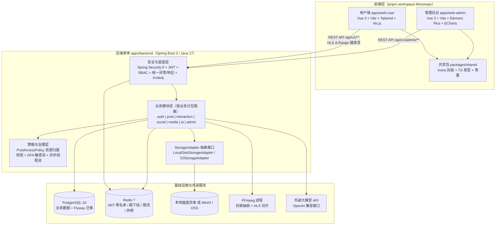
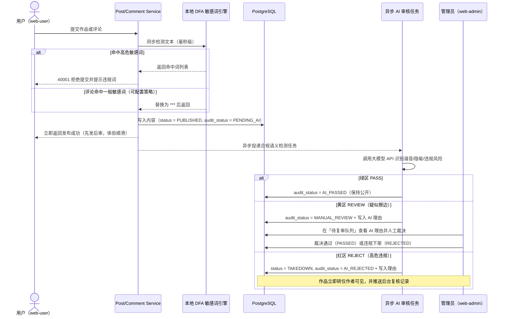
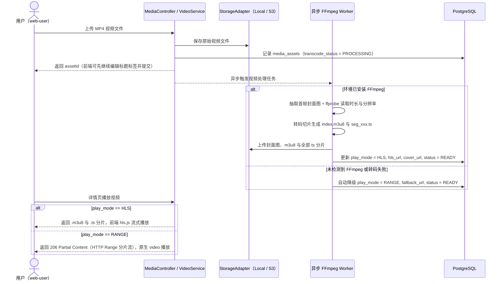
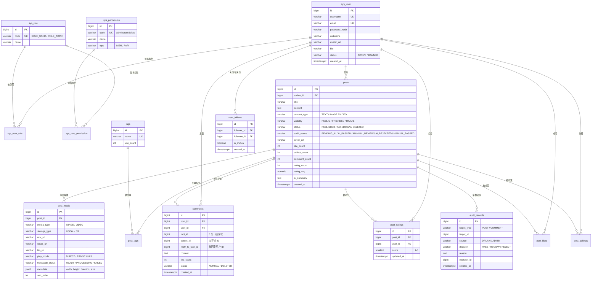

# 多媒体社区展示系统 · 总体设计与技术方案草案（v0.1）

> **文档状态**：初版草案（供团队评审）  
> **文档目标**：对齐产品形态、系统架构、技术栈、核心数据模型与公共契约规范。全组审阅并敲定本方案后，再据此微调并锁定 8 人具体分工。  
> **本地演示前提**：支持全链路本地运行演示（断网可用），开发期可按需切换至共享云服务器数据库与 Redis。

---

## 1. 产品定位与课程需求映射

### 1.1 产品形态

系统定位为**仿小红书官方网页版的多媒体内容社区**（无独立桌面客户端），搭配一个**独立的管理员 Web 后台**：

- **用户端（`web-user`）**：纯 Vue 3 响应式网页应用。桌面宽屏展示左侧导航 + 多列瀑布流 + 作品详情弹窗/独立页；窄屏自动切换为移动端双列瀑布流 + 底部导航。
- **管理后台（`web-admin`）**：独立 Vue 3 运营与审核后台，覆盖用户、内容、评论、标签、敏感词、角色权限管理及数据统计可视化。
- **单后端架构**：用户端与管理端共用同一套 Spring Boot 3 后端服务、同一套数据库与同一套认证授权体系。

### 1.2 课程要求与加分项对照表

| 课程原文要求 | 本项目落地形态 | 对应核心模块 |
| :--- | :--- | :--- |
| 上传图片、视频、文本；查看、修改、删除自己上传的内容 | 支持三种独立作品形态（单篇不混排）：图文（1~9 图 + 标题正文）、单视频（1 视频 + 封面 + 标题正文）、纯文本；个人主页「我的作品」支持编辑与删除 | `post`、`media` |
| 上传内容增加标签，支持按日期、标签等多种形式检索 | 支持自定义与推荐标签（多对多）；发现页与搜索页支持关键词、标签、发布日期区间组合筛选与排序 | `post` |
| 其他人对内容评价（打分）、评论（类似朋友圈评论） | 独立 1~5 星评分（每人每篇限评 1 次且可改分，作者不可自评，展示平均分与评分人数）+ 小红书式两级平铺评论回复 + 点赞与收藏 | `interaction` |
| 用户可以设置自己的登录密码 | 用户名/邮箱 + 密码注册登录，BCrypt 哈希落库，个人中心支持修改/重设密码 | `auth` |
| **加分项：好友功能** | 关注/取关体系，**互相关注即好友**；提供关注流、粉丝/关注列表、个人主页，以及作品三档可见性（公开 / 仅好友可见 / 仅自己可见） | `social`、`post` |
| **加分项：敏感词过滤** | 后端内置 DFA 前缀树词库，提交时毫秒级检测（高危词硬拦截，评论一般词支持拦截或自动打码 `***`），管理后台支持动态维护词库并热更新 | `moderation`、`admin` |
| **加分项：视频流处理** | 上传后后端异步调 FFmpeg 抽取首帧封面、提取时长分辨率并切片为 HLS（`.m3u8` + `.ts`），前端用 `hls.js` 流式播放；无 FFmpeg 环境自动降级为 HTTP Range（`206 Partial Content`）分片流 | `media` |
| **加分项：大模型处理** | 后端统一代理 OpenAI 兼容接口 + Redis 频控，落地三个场景：① 发布页 AI 助手（推荐标签/润色/摘要）；② 详情页 AI 内容与评论总结；③ 发布后异步 AI 合规语义复查 | `ai` |
| **Web 后台：用户与内容管理** | 管理员查/封禁/删用户（Redis 即时踢下线）、查/审/下架/删作品、管评论与标签、维护敏感词库、5 表 RBAC 角色与权限配置 | `admin`、`auth` |
| **加分项：用户使用与活跃统计图** | 管理后台 ECharts 数据看板：核心指标卡、用户注册与发帖趋势折线图、热门标签分布、内容类型占比饼图、高分作品与活跃用户排行 | `admin` |

---

## 2. 系统总体架构与技术栈

### 2.1 系统架构图



### 2.2 技术栈明细

| 层次 | 选型 | 选型理由 |
| :--- | :--- | :--- |
| **用户端前端** | Vue 3 + TypeScript + Vite + Pinia + Vue Router + Tailwind CSS + `hls.js` | 符合课程 Vue 要求；Tailwind 适合快速还原小红书卡片与响应式双列瀑布流；`hls.js` 原生支持浏览器播放 `.m3u8` 流 |
| **管理后台前端** | Vue 3 + TypeScript + Vite + Pinia + Vue Router + Element Plus + ECharts | 与用户端统一 Vue 3 语法栈；Element Plus 覆盖表格、表单、树形权限配置；ECharts 覆盖统计分析加分项 |
| **前端包管理** | `pnpm` + `pnpm workspace` | 物理隔离两套 Vue 工程的样式与依赖，同时通过 `packages/shared` 实时共享 Axios 封装与接口类型 |
| **后端框架** | Java 17 + Spring Boot 3.x | 课程硬性要求；模块化单体部署简单，按业务分包降低 8 人并行冲突 |
| **数据访问与迁移** | MyBatis-Plus + Flyway | MyBatis-Plus 简化分页、条件查询与逻辑删除；Flyway 通过版本化 SQL 脚本保证 8 人本地数据库表结构一致 |
| **认证与权限** | Spring Security 6 + JJWT + Redis | 行业标准组合；支持标准 5 表 RBAC 权限点校验、游客匿名白名单、JWT 主动失效与封禁即时踢下线 |
| **关系型数据库** | PostgreSQL 16 | 原生支持 `JSONB`（存媒体元数据/AI 分析结果）、`pg_trgm` 扩展（中文模糊搜索）、强并发一致性 |
| **缓存与状态** | Redis 7 | 承担 JWT 登出黑名单、用户封禁状态、热榜 `ZSET`、大模型接口按用户/IP 频率限流、敏感词版本号同步 |
| **文件存储抽象** | `StorageAdapter` 接口 | 默认提供 `LocalDiskStorageAdapter`（离线本地演示零依赖）与 `S3StorageAdapter`（兼容 MinIO / 阿里云 OSS / 腾讯云 COS），按 `app.storage.type` 配置切换 |
| **视频处理** | FFmpeg（外部进程异步调用） | 上传后异步抽首帧图、读元信息并切片为 HLS；探测不到 FFmpeg 时自动走 HTTP Range 兜底 |
| **接口文档** | SpringDoc OpenAPI 3 + Knife4j | 后端写注解即自动生成可在线调试的接口文档，作为前后端联调唯一依据 |
| **本地与云端环境** | Docker Compose + Spring Profile | 根目录 `docker-compose.yml` 一键拉起本地 PG + Redis；通过 `dev-local` / `dev-cloud` Profile 一键切换本地库与云服务器共享库 |

---

## 3. 核心业务规则设计

### 3.1 作品形态、可见性与检索

1. **媒体形态（`content_type`）**：单篇作品只能属于以下三者之一，不允许图片与视频混排：
   - `TEXT`：纯文本（标题 + 正文）
   - `IMAGE`：图文（1~9 张图片 + 标题 + 正文）
   - `VIDEO`：单视频（1 个视频 + 自动抽帧或用户上传封面 + 标题 + 正文）
2. **可见性权限（`visibility`）**：
   - `PUBLIC`：所有用户与未登录游客均可见
   - `FRIENDS`：仅作者本人及与作者**互相关注**的好友可见
   - `PRIVATE`：仅作者本人可见（含私密笔记与违规被自动下架后的受限态，通过 `status` 字段区分）
3. **多维检索**：支持按**关键词**（匹配标题与正文）、**单个/多个标签**、**发布日期区间**（`startDate` ~ `endDate`）、**内容类型**组合过滤，并支持按最新、最热（点赞/收藏/评分加权）、最高评分排序。

### 3.2 评论、评分与社交互动

- **两级平铺评论（小红书模式）**：
  - 直接评论作品的为一级评论（`root_id = 0`、`parent_id = 0`）。
  - 回复一级评论或回复其他子评论时，统一挂在该条一级评论下（`root_id = 一级评论 ID`），同时记录 `parent_id` 与 `reply_to_user_id`，UI 展示为 `回复 @某人：内容`。
  - 详情页查询一级评论分页（按热度或时间倒序），并随主评论返回前 2 条子回复；点击“展开更多回复”再按 `root_id` 时间正序分页拉取。
- **独立 1~5 星评分**：
  - 数据库按 `(post_id, user_id)` 建唯一约束：每名登录用户对每篇作品限评 1 次，再次提交视为修改评分。
  - 作者不可给自己作品评分。
  - 作品表冗余维护 `rating_sum`、`rating_count`、`rating_avg`（或在评分写入时事务更新），列表页与详情页直接读取展示，如 `4.8 分（23 人评）`。
- **互关即好友**：
  - `user_follows` 表记录单向关注 `(follower_id, followee_id)`。
  - 当 `(A -> B)` 与 `(B -> A)` 同时存在时，判定 A 与 B 为好友关系（可在关注/取关时同步维护双向关系标识 `is_mutual`，查询“仅好友可见”作品列表时避免昂贵自连接）。

### 3.3 认证、双层权限模型与游客访问

权限拆为两层，由认证与权限底座（原包 1）统一封装，其他模块严禁手写零散的权限判断：

1. **游客只读策略**：
   - 放行接口（无需登录）：公开瀑布流、标签列表、关键词/日期检索、公开作品详情、公开评论列表、用户公开主页、登录/注册接口。
   - 需登录接口：发布/编辑/删除作品、点赞/收藏/评分/发评论、关注流、查看好友/私密作品、个人设置与修改密码、AI 助手接口。
   - 前端拦截器收到 `401` 时统一拉起登录弹窗，不强制中断浏览路径。
2. **第一层：功能级权限（标准数据库 5 表 RBAC）**：
   - `sys_user`、`sys_role`、`sys_permission`、`sys_user_role`、`sys_role_permission`。
   - 内置初始角色：`ROLE_USER`（普通用户）、`ROLE_MODERATOR`（内容审核员，可选演示）、`ROLE_ADMIN`（超级管理员）。
   - Controller 接口统一使用 `@PreAuthorize("hasAuthority('admin:post:delete')")` 声明权限点；管理后台支持动态创建角色、为角色勾选权限、为用户分配角色，权限变更后清理该用户在 Redis 中的权限缓存立即生效。
3. **第二层：数据归属与可见性权限（策略层校验）**：
   - 统一封装 `PostAccessPolicy` 与 `CommentAccessPolicy`：
     - **读权限 `canView(viewerId, viewerAuthorities, post)`**：管理员或作者本人放行；非正常状态作品拒绝；`PUBLIC` 放行；`FRIENDS` 校验互关关系；`PRIVATE` 拒绝。
     - **写/删权限 `canModify(operatorId, operatorAuthorities, post)`**：仅作者本人放行；管理员具备 `admin:post:delete` 权限时可执行管理侧下架/删除。

### 3.4 人机协同先发后审流程

结合本地 DFA 词库、大模型语义理解和 Web 后台审核队列，形成同步拦截 + 异步复查链路：



### 3.5 视频流处理与降级流程



---

## 4. 核心数据模型与 ER 关系图

### 4.1 领域 ER 图



### 4.2 补充基础表（未画入主图以保持清晰）

- **`sensitive_words`**：`id`、`word`（唯一索引）、`level`（`HIGH` 硬拦截 / `NORMAL` 可替换 `***`）、`category`、`enabled`、`updated_at`。每次后台增删改后刷新内存 DFA 树，并更新 Redis 版本号。
- **`sys_user_role`** / **`sys_role_permission`** / **`post_tags`**：标准联合主键中间表。
- **`post_likes`** / **`post_collects`**：`(post_id, user_id)` 联合唯一索引，防重复点赞与收藏。

### 4.3 PostgreSQL 索引约定

- 所有时间字段统一使用 `TIMESTAMPTZ`（带时区），后端统一输出 ISO-8601 字符串。
- `posts` 表建立复合索引 `(status, visibility, created_at DESC)` 支撑发现页瀑布流；启用 `pg_trgm` 扩展并在 `title` / `content` 上建 GIN 索引加速中文模糊搜索。
- `comments` 表建立 `(post_id, root_id, created_at DESC)` 索引支撑两级评论分页查询。
- `user_follows` 表建立唯一索引 `(follower_id, followee_id)` 及辅助索引 `(followee_id, is_mutual)`。

---

## 5. 统一接口规范草案（底座契约）

本节由账号权限与接口规范模块（原包 1）牵头维护，所有模块开发前须对齐此约定。

### 5.1 路由前缀与版本规范

所有后端 API 统一挂载 `/api/v1` 前缀，按访问边界划分路径：

| 路径前缀 | 适用对象 | 鉴权要求 |
| :--- | :--- | :--- |
| `/api/v1/auth/**` | 登录、注册、刷新 Token、登出 | 登录/注册放行，登出与修改密码需登录 |
| `/api/v1/public/**` | 可选显式公开只读接口（或同业务前缀按 HTTP Method 放行 GET） | 游客放行；携带合法 Token 时注入当前用户上下文以计算点赞/关注/好友可见性 |
| `/api/v1/posts/**`、`/api/v1/users/**`、`/api/v1/comments/**`、`/api/v1/media/**`、`/api/v1/ai/**` | 用户端核心业务接口 | GET 公开查询按策略放行，POST/PUT/PATCH/DELETE 全部要求登录 |
| `/api/v1/admin/**` | 管理后台全量接口（含 RBAC 管理、待复审队列、敏感词、统计图表） | 强制登录 + RBAC 权限点注解（`@PreAuthorize`） |

### 5.2 统一响应体格式

无论成功或业务失败，均返回统一 JSON 结构（文件流/HLS 分片接口除外）：

```json
{
  "code": 0,
  "message": "ok",
  "data": {},
  "traceId": "a1b2c3d4e5f6"
}
```

**统一分页结构（`PageResult<T>`）**：

```json
{
  "code": 0,
  "message": "ok",
  "data": {
    "items": [],
    "page": 1,
    "pageSize": 20,
    "total": 128,
    "hasMore": true
  },
  "traceId": "a1b2c3d4e5f6"
}
```

- 瀑布流加载更多时，前端既可使用 `page` / `pageSize` 常规分页，也可对首页流约定可选 `cursor`（最后一条记录的 `createdAt + id`）防止新帖插入导致翻页重复。

### 5.3 HTTP 状态码与业务错误码分段

HTTP 状态码表达传输/安全语义（`200` / `400` / `401` / `403` / `404` / `429` / `500`），业务 `code` 精确区分具体错误，各模块按号段认领，杜绝碰撞：

| 错误码号段 | 归属域 | 典型示例 |
| :--- | :--- | :--- |
| `0` | 成功 | `0` 成功 |
| `10000 ~ 10999` | 公共参数与系统异常 | `10001` 参数校验失败、`10429` 请求过于频繁、`10500` 服务内部错误 |
| `20000 ~ 20999` | `auth` 账号与权限 | `20001` 未登录或 Token 过期、`20002` 账号或密码错误、`20003` 无操作权限、`20004` 账号已封禁、`20005` 用户名或邮箱已存在 |
| `30000 ~ 30999` | `post` / `media` 发布与媒体 | `30001` 作品不存在或无权查看、`30002` 媒体类型不支持、`30003` 文件超出大小限制、`30004` 触发敏感词拦截 |
| `40000 ~ 40999` | `interaction` 互动与评价 | `40001` 作者不可给自己打分、`40002` 评分超出 1~5 范围、`40003` 父评论不存在 |
| `50000 ~ 50999` | `social` 关注与好友 | `50001` 不能关注自己、`50002` 目标用户不存在 |
| `60000 ~ 60999` | `ai` 大模型服务 | `60001` 今日 AI 调用次数已达上限、`60002` 上游大模型超时或不可用（前端降级提示） |
| `70000 ~ 70999` | `admin` 管理后台 | `70001` 内置超管角色不可删除、`70002` 敏感词已存在 |

### 5.4 Token 与会话约定

- **Header 传递**：`Authorization: Bearer <accessToken>`。
- **双 Token 机制**：
  - `accessToken`（短期，如 2 小时）：无状态携带 `userId`、`jti`（唯一 ID），请求时校验 Redis 黑名单（登出/改密/封禁后立即失效）。
  - `refreshToken`（长期，如 7 天，存 Redis）：`accessToken` 过期后前端 Axios 拦截器无感调 `/api/v1/auth/refresh` 换新。
- **修改密码与封禁联动**：用户修改密码或管理员封禁用户时，立即清除其 Redis Refresh Token 并拉黑当前有效会话，强制重新登录。

### 5.5 核心接口清单示例（底座首批交付）

- `POST /api/v1/auth/register`：账号注册（用户名、邮箱、密码）
- `POST /api/v1/auth/login`：密码登录，返回双 Token 与基础用户信息及权限点列表
- `POST /api/v1/auth/refresh`：刷新 Access Token
- `POST /api/v1/auth/logout`：退出登录（当前 Token 写入 Redis 黑名单）
- `PUT /api/v1/auth/password`：修改当前用户登录密码（校验旧密码）
- `GET /api/v1/auth/me`：获取当前登录用户信息、角色与权限点（前端用于渲染管理后台菜单和按钮权限）

---

## 6. Monorepo 目录结构与 8 人协作防冲突规范

### 6.1 仓库目录布局

```text
project-root/
├── package.json                 # 根目录一键脚本（pnpm dev 同时拉起 web-user 与 web-admin）
├── pnpm-workspace.yaml          # 声明 apps/* 与 packages/*
├── docker/
│   └── docker-compose.yml       # 一键起 PostgreSQL 16 + Redis 7（+ 可选 MinIO）
├── docs/
│   ├── design-proposal-v0.1.md  # 本设计方案文档
│   └── api-conventions.md       # 接口与错误码速查
├── packages/
│   └── shared/                  # 前后端通用 TS 类型、Axios 封装、错误码与枚举常量
└── apps/
    ├── web-user/                # 用户端 Vue 3（小红书响应式网页版）
    │   └── src/
    │       ├── views/           # discover / follow / detail / publish / profile / search
    │       ├── components/      # WaterfallGrid / PostCard / CommentDrawer / RatingBox / VideoPlayer
    │       └── stores/          # auth / feed
    ├── web-admin/               # 管理后台 Vue 3（Element Plus + ECharts）
    │   └── src/
    │       ├── views/           # dashboard / users / posts / audit-queue / comments / tags / words / rbac
    │       └── stores/          # auth / permission
    └── backend/                 # 唯一 Spring Boot 3 后端（按业务模块分包）
        └── src/main/
            ├── java/com/community/
            │   ├── common/      # 统一响应、异常、分页、Redis Key 常量、安全上下文工具（底座维护）
            │   ├── storage/     # StorageAdapter 接口 + LocalDisk / S3 实现
            │   ├── module/
            │   │   ├── auth/        # 注册登录、密码、JWT/Redis、5 表 RBAC、权限管理接口
            │   │   ├── post/        # 作品 CRUD、可见性策略 PostAccessPolicy、检索、标签
            │   │   ├── media/       # 文件上传、FFmpeg 异步 HLS 切片、HTTP Range 分片流
            │   │   ├── interaction/ # 点赞、收藏、两级评论回复、1~5 星评分
            │   │   ├── social/      # 关注取关、互关好友判定、关注流、个人主页数据
            │   │   ├── moderation/  # DFA 前缀树引擎、敏感词管理、异步审核流编排
            │   │   ├── ai/          # OpenAI 兼容客户端、Redis 限流、标签助手/总结/合规审
            │   │   └── admin/       # 后台聚合管理视图与 ECharts 统计查询
            └── resources/
                ├── application.yml
                ├── application-dev-local.yml   # 连本地 Docker PG + Redis + LocalDisk
                ├── application-dev-cloud.yml   # 连云服务器共享 PG + Redis
                └── db/migration/               # Flyway 脚本：V1__init_rbac.sql, V2__init_post.sql ...
```

### 6.2 防止 8 人合并冲突的 5 条硬约定

1. **目录归属隔离**：每个业务功能尽量只在自己对应的 `apps/backend/src/main/java/com/community/module/<模块>/` 及对应前端 `views/<页面>/` 下增删文件。涉及 `common/` 或 `packages/shared/` 的公共改动，统一走 PR 评审合入。
2. **数据库变更只走 Flyway**：禁止手动在共享库建表或改字段。新增/修改表结构必须新增递增版本号脚本（如 `V20261125_01__add_ai_summary.sql`），拉代码启动服务自动执行。
3. **API 契约先行**：后端新写接口必须补齐 `@Tag` / `@Operation` Knife4j 注解与 DTO 校验注解，前端直接对照 Knife4j 在线文档（`http://localhost:8080/doc.html`）对接，减少口头沟通误差。
4. **分支与提交策略**：`main` 分支受保护；开发从 `dev` 切出特性分支 `feat/<模块>-<功能>`，自测通过后提 PR 合并到 `dev`，严禁把 API Key、数据库密码、本地上传目录提交到 Git（统一用 `.env` 和 `.gitignore` 隔离）。
5. **外部依赖降级开关**：FFmpeg 未安装自动切 HTTP Range 播放；大模型 API Key 未配置或超限流时返回明确业务码 `60001`/`60002`，前端友好提示而不影响发帖和浏览主流程。

---

## 7. 后续分工评估参考（待方案评审后定人）

> 当前先确认架构与技术草案，**暂不锁死最初的分工表**。相比原方案，本版架构新增了 **5 表 RBAC 动态权限**、**人机协同异步审核流**、**HLS 异步切片** 和 **3 项大模型场景**，模块工作量分布发生了变化。建议组员审阅完本方案后，按以下 8 个解耦度高、工作量相对均衡的模块重新认领或微调：

| 建议模块 | 核心职责（前后端纵切或按人微调） | 相对复杂度评估 | 对底座的依赖 |
| :--- | :--- | :--- | :--- |
| **M1. 底座与账号权限（已定你负责）** | Monorepo 脚手架、Docker Compose、Flyway 基线、`common` 响应/异常规范、注册登录改密、Spring Security + JWT + Redis 踢下线、5 表 RBAC 后端与后台角色权限页 | 高（前置关键路径，须最先落地最小可用骨架） | 无（自身即底座） |
| **M2. 媒体存储与视频流** | `StorageAdapter`（Local/S3）、图片/视频上传接口、FFmpeg 异步抽封面 + HLS 切片 + HTTP Range 降级接口、前端视频播放器组件（`hls.js`） | 中高（异步任务 + FFmpeg 调试） | 依赖 M1 鉴权与 `common` |
| **M3. 内容发布与管理** | 作品发布/编辑/删除（图文/视频/纯文三形态 + 三档可见性）、`PostAccessPolicy` 可见性校验、标签 CRUD、我的作品页 | 中 | 依赖 M1、M2 上传能力 |
| **M4. 发现浏览与多维检索** | 用户端响应式导航框架、首页多列/双列瀑布流、作品详情页、关键词/标签/日期区间组合检索与排序 | 中（前端视觉质感核心） | 依赖 M1、M3 作品数据 |
| **M5. 互动与评价体系** | 点赞、收藏（及我的收藏页）、小红书两级平铺评论与回复分页、1~5 星独立评分（防自评与均分汇总） | 中 | 依赖 M1、M3 |
| **M6. 社交与好友圈** | 关注/取关、互关好友关系维护、粉丝/关注列表、用户个人主页、关注流（含好友可见作品展示） | 中 | 依赖 M1、M3 |
| **M7. 内容治理与大模型** | DFA 敏感词引擎 + 词库管理、OpenAI 兼容代理 + Redis 限流、发布页 AI 助手、详情页 AI 总结、异步 AI 合规三区审核流 | 高（串联 3 个加分项） | 依赖 M1、M3、M5 |
| **M8. 管理后台、统计图与交付保障** | 管理后台框架、用户/作品/评论/标签/待复审队列页面、ECharts 统计分析看板；全组集成测试、种子数据脚本、课程报告与答辩 PPT（可将后台页面与测试/文档按实际人手再平衡） | 中高（收尾集成核心） | 依赖各模块接口 |

---

## 8. 供组员审阅的待确认议题

发给组员讨论时，建议重点对齐以下 5 个具体问题，收口后即可初始化仓库并启动编码：

1. **项目命名与视觉主题**：给社区起一个简洁的名称（如校园/通用生活分享社区），确定主色调与 Logo。
2. **评论区一般敏感词策略**：统一采用「命中直接拦截拒绝」，还是「高危词拦截、一般不文明词自动替换为 `***` 放行」？
3. **开发期基础设施模式**：大家统一连云服务器上的共享 PostgreSQL + Redis（省去装 Docker），还是默认每人本机跑 `docker-compose.yml`？
4. **大模型服务商与额度分配**：确定使用的 OpenAI 兼容模型（如 DeepSeek / Qwen / GPT），以及开发测试阶段的单人每日调用限流阈值。
5. **8 人最终分工认领**：对照第 7 节模块表确认每人负责范围，尤其确认 M1 底座骨架与 M8 后台/测试文档的人力配比，并约定每周同步节点。
