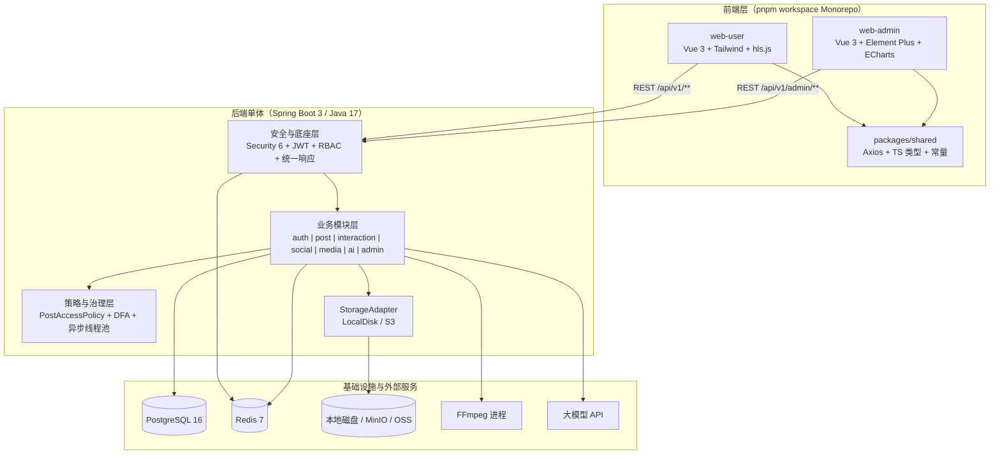
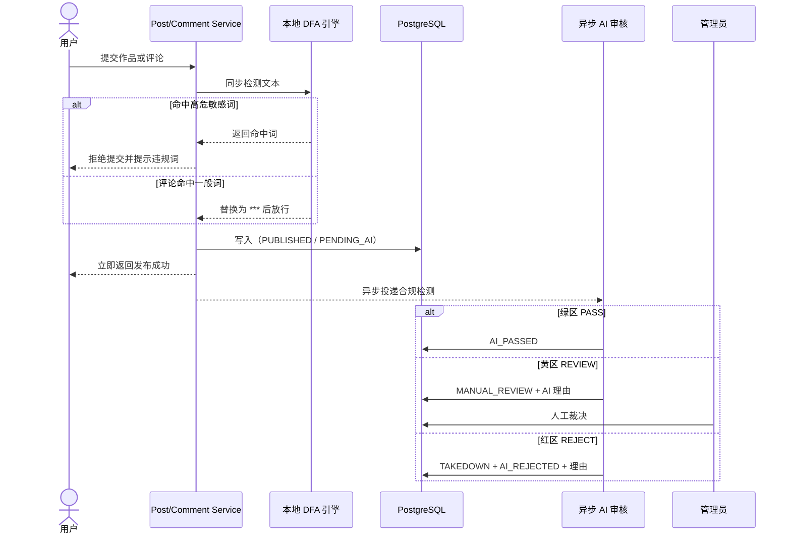
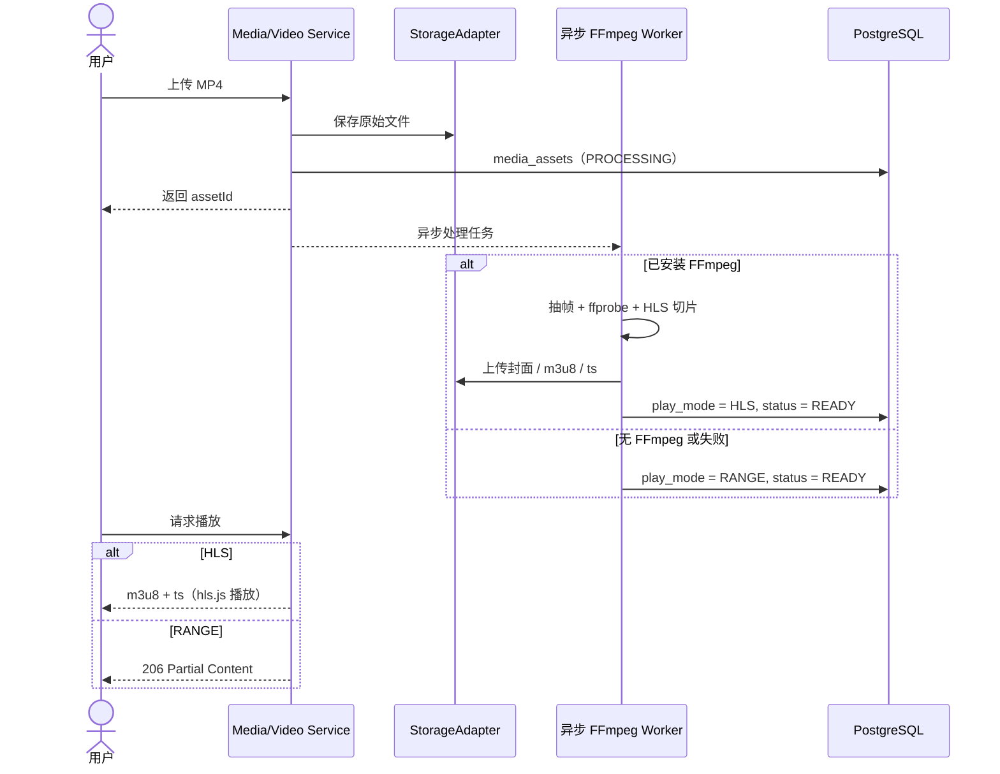

# 多媒体社区展示系统 · 技术设计汇总（供 PPT 素材）

> **文档状态**：技术设计汇总稿（供 PPT 制作使用）  
> **文档用途**：期末大作业初期汇报，向老师说明系统定位、架构与核心设计  
> **配套文档**：`design-proposal-v0.1.md`、`work-packages-and-schedule-v1.1.md`  
> **组织说明**：本文按技术设计主题组织，不规定 PPT 页序与版式，做 PPT 的同学可自由拆并取舍  
> **内容边界**：只讲设计内容与设计理由，不涉及分工、排期与未决问题

---

## 1. 系统定位与形态

**一句话定位**：仿小红书网页版的多媒体内容社区，配一个独立管理员 Web 后台，后端为单一 Spring Boot 3 服务。

- **用户端**：Vue 3 响应式网页。桌面宽屏为左侧导航 + 多列瀑布流 + 作品详情弹窗/独立页；窄屏自动切换为双列瀑布流 + 底部导航。
- **管理后台**：独立 Vue 3 运营与审核后台，覆盖用户、内容、评论、标签、敏感词、角色权限管理及数据统计可视化。
- **单后端架构**：用户端与管理端共用同一套 Spring Boot 3 服务、同一套数据库、同一套认证授权体系。
- **演示前提**：支持全链路本地运行，断网可用；开发期可按需切换共享云数据库与 Redis。

**设计理由**：双前端物理隔离样式与依赖，单后端避免两套认证与数据模型分裂；本地可运行保证课堂演示不依赖网络。

---

## 2. 课程要求与落地形态对照

| 课程要求 | 落地形态 | 涉及模块 |
| :--- | :--- | :--- |
| 上传图片、视频、文本；查看/修改/删除自己的内容 | 三种独立作品形态（单篇不混排）：图文 1~9 图、单视频、纯文本；“我的作品”支持编辑与删除 | `post`、`media` |
| 标签 + 按日期/标签检索 | 自定义与推荐标签多对多；关键词 + 标签 + 发布日期区间 + 内容类型组合筛选与排序 | `post` |
| 他人打分与评论 | 独立 1~5 星评分（每人每篇限 1 次可改、作者不可自评、展示均分与人数）+ 两级平铺评论回复 + 点赞收藏 | `interaction` |
| 用户设置登录密码 | 用户名/邮箱 + 密码注册登录，BCrypt 哈希落库，个人中心可改密/重设 | `auth` |
| 加分项：好友功能 | 关注/取关，互相关注即好友；关注流、粉丝/关注列表、个人主页、作品三档可见性 | `social`、`post` |
| 加分项：敏感词过滤 | 后端 DFA 前缀树，提交时毫秒级检测；高危词硬拦截，一般词可拦截或打码；后台可维护词库并热更新 | `moderation`、`admin` |
| 加分项：视频流处理 | 上传后异步 FFmpeg 抽首帧 + 读元信息 + HLS 切片；无 FFmpeg 自动降级 HTTP Range 分片流 | `media` |
| 加分项：大模型处理 | 后端代理 OpenAI 兼容接口 + Redis 频控；发布页 AI 助手、详情页 AI 总结、发布后异步合规复查 | `ai` |
| Web 后台：用户与内容管理 | 查/封禁/删用户（封禁即时踢下线）、查/审/下架/删作品、管评论与标签、维护敏感词、5 表 RBAC | `admin`、`auth` |
| 加分项：活跃统计图 | ECharts 看板：指标卡、注册与发帖趋势、热门标签分布、内容类型占比、高分作品与活跃用户排行 | `admin` |

**设计理由**：逐条对应课程原文，确保无漏项；加分项全部落到具体模块，不是口号。

---

## 3. 总体架构

**四层结构，自外向内：**

1. **前端层（pnpm workspace Monorepo）**
   - `web-user`：Vue 3 + Vite + Tailwind + `hls.js`
   - `web-admin`：Vue 3 + Vite + Element Plus + ECharts
   - `packages/shared`：Axios 封装 + TS 类型 + 常量，两端共享
2. **后端单体（Spring Boot 3 / Java 17）**
   - 安全与底座层：Spring Security 6 + JWT + RBAC + 统一响应/异常 + Knife4j
   - 业务模块层：`auth` / `post` / `interaction` / `social` / `media` / `ai` / `admin`，按业务分包隔离
   - 策略与治理层：`PostAccessPolicy` 资源归属校验 + DFA 敏感词 + 异步线程池
   - 存储抽象层：`StorageAdapter` 接口，LocalDisk 与 S3 两种实现
3. **基础设施**
   - PostgreSQL 16（业务数据 + Flyway 迁移）
   - Redis 7（JWT 黑名单 / 踢下线 / 限流 / 热榜）
   - 本地磁盘或 MinIO/OSS
4. **外部服务**
   - FFmpeg 进程（抽帧 + HLS 切片）
   - 大模型 API（OpenAI 兼容接口）

**调用关系一句话**：前端经 `/api/v1/**` REST 调用后端；后端读写 PG/Redis，经 `StorageAdapter` 落文件，经 FFmpeg 与 LLM 做异步处理。

**架构简图（Mermaid，可选放入 PPT 附件）：**



**设计理由**：模块化单体在 8 人协作下部署简单、按业务分包降低冲突；存储与外部服务都走抽象/降级，保证本地可演示。

---

## 4. 技术栈与选型理由

| 层次 | 选型 | 选型理由 |
| :--- | :--- | :--- |
| 用户端前端 | Vue 3 + TS + Vite + Pinia + Tailwind + `hls.js` | 符合课程 Vue 要求；Tailwind 快速还原小红书卡片与响应式瀑布流；`hls.js` 原生播 m3u8 |
| 管理后台前端 | Vue 3 + TS + Vite + Element Plus + ECharts | 与用户端统一语法栈；Element Plus 覆盖表格/表单/树形权限；ECharts 覆盖统计 |
| 包管理 | pnpm workspace | 两套 Vue 工程样式依赖隔离，共享包实时复用 Axios 与接口类型 |
| 后端框架 | Java 17 + Spring Boot 3 | 课程硬性要求；模块化单体部署简单，按业务分包降低并行冲突 |
| 数据访问与迁移 | MyBatis-Plus + Flyway | 简化分页与条件查询；版本化 SQL 保证多人本地表结构一致 |
| 认证与权限 | Spring Security 6 + JJWT + Redis | 标准 5 表 RBAC、游客白名单、JWT 主动失效与封禁即时踢下线 |
| 关系型数据库 | PostgreSQL 16 | JSONB 存媒体/AI 元数据、`pg_trgm` 中文模糊搜索、强并发一致性 |
| 缓存与状态 | Redis 7 | JWT 黑名单、封禁状态、热榜 ZSET、大模型限流、敏感词版本号 |
| 文件存储抽象 | `StorageAdapter` 接口 | 本地磁盘零依赖演示；S3 兼容 MinIO/OSS/COS，配置切换 |
| 视频处理 | FFmpeg 外部进程 | 异步抽帧 + HLS 切片；探测不到自动走 HTTP Range 兜底 |
| 接口文档 | SpringDoc OpenAPI 3 + Knife4j | 注解即生成可在线调试文档，作为前后端联调唯一依据 |

**设计理由**：选型优先满足课程硬性要求，其次考虑 8 人并行协作的一致性与本地演示可靠性。

---

## 5. 核心业务规则

### 5.1 作品形态与可见性

**三种作品形态，单篇不混排：**

| 类型 | 组成 |
| :--- | :--- |
| `TEXT` 纯文本 | 标题 + 正文 |
| `IMAGE` 图文 | 1~9 张图片 + 标题 + 正文 |
| `VIDEO` 单视频 | 1 个视频 + 封面（自动抽帧或用户上传）+ 标题 + 正文 |

**三档可见性：**

| 可见性 | 可见范围 |
| :--- | :--- |
| `PUBLIC` | 所有用户与未登录游客 |
| `FRIENDS` | 作者本人 + 与作者互相关注的好友 |
| `PRIVATE` | 仅作者本人（含私密笔记与违规下架受限态，用 `status` 区分） |

**多维检索**：关键词（匹配标题与正文）、单个/多个标签、发布日期区间、内容类型组合过滤；排序支持最新、最热（点赞/收藏/评分加权）、最高评分。

**设计理由**：不混排简化媒体模型与前端渲染；三档可见性是好友加分项的基础，用策略层统一校验而非散落判断。

### 5.2 评论、评分与好友

**两级平铺评论（小红书模式）：**

- 直接评论作品为一级评论（`root_id = 0`、`parent_id = 0`）。
- 回复一级评论或其他子评论，统一挂在该一级评论下（`root_id = 一级评论 ID`），同时记录 `parent_id` 与 `reply_to_user_id`。
- UI 展示为“回复 @某人：内容”；一级评论分页返回前 2 条子回复，展开再按 `root_id` 时间正序分页拉取。

**独立 1~5 星评分：**

- `(post_id, user_id)` 唯一约束：每人每篇限评 1 次，再次提交视为修改评分。
- 作者不可给自己作品评分。
- 作品表冗余 `rating_sum / rating_count / rating_avg`，列表与详情直接读，展示如“4.8 分（23 人评）”。

**互关即好友：**

- `user_follows` 记录单向关注 `(follower_id, followee_id)`。
- 双向同时存在判定为好友；关注/取关时同步维护 `is_mutual`，查“仅好友可见”作品时避免昂贵自连接。

**设计理由**：评论树用 root/parent 双字段兼顾展示与查询效率；评分唯一约束保证数据一致；`is_mutual` 冗余换查询性能。

### 5.3 双层权限模型

**第一层：功能级权限（标准 5 表 RBAC）**

- 表：`sys_user`、`sys_role`、`sys_permission`、`sys_user_role`、`sys_role_permission`。
- 内置角色：`ROLE_USER`、`ROLE_MODERATOR`（可选演示）、`ROLE_ADMIN`。
- Controller 统一用 `@PreAuthorize("hasAuthority('admin:post:delete')")` 声明权限点。
- 后台支持动态建角色、勾权限、分配角色；权限变更清 Redis 缓存立即生效。

**第二层：数据归属与可见性权限（策略层）**

- 统一封装 `PostAccessPolicy` 与 `CommentAccessPolicy`：
  - 读权限 `canView`：管理员或作者放行；非正常状态拒绝；`PUBLIC` 放行；`FRIENDS` 校验互关；`PRIVATE` 拒绝。
  - 写/删权限 `canModify`：仅作者本人；管理员具备对应权限点时可执行管理侧下架/删除。

**游客只读策略**：公开瀑布流、标签列表、检索、公开详情与评论、公开主页、登录注册放行；发布/互动/关注流/私密内容/AI 接口需登录；前端收到 `401` 统一拉起登录弹窗，不中断浏览路径。

**设计理由**：功能权限与数据权限分离，其他模块严禁手写零散权限判断，保证越权校验可审计、可复用。

---

## 6. 内容治理：人机协同先发后审

**同步拦截 + 异步复查，四步流程：**

1. 用户提交作品/评论 → 本地 DFA 同步检测（毫秒级）
   - 命中高危词：拒绝提交并提示违规词
   - 评论命中一般词：按策略替换为 `***` 后放行
2. 写入数据库，`status = PUBLISHED`、`audit_status = PENDING_AI`，立即返回发布成功（先发后审，体验顺滑）
3. 异步投递 AI 合规语义检测（识别谐音/隐喻/违规风险）
   - 绿区 PASS → `AI_PASSED`，保持公开
   - 黄区 REVIEW → `MANUAL_REVIEW` + 写 AI 理由，进入后台待复审队列
   - 红区 REJECT → `status = TAKEDOWN`，作品转仅作者可见，写理由并推送后台复核记录
4. 管理员在后台待复审队列查看 AI 理由并人工裁决

**治理时序简图（Mermaid，可选放入 PPT 附件）：**



**设计理由**：同步 DFA 保体验与硬底线，异步大模型补语义盲区，人工兜底处理疑似擦边；三层各司其职，AI 不可用时不影响发布主流程。

---

## 7. 视频流处理与降级

**上传后异步处理，两条路径：**

| 条件 | 处理 | 播放方式 |
| :--- | :--- | :--- |
| 环境已安装 FFmpeg | 抽首帧封面 + ffprobe 读时长分辨率 + 转码切片生成 `index.m3u8` 与 `seg_xxx.ts` | `play_mode = HLS`，前端 `hls.js` 流式播放 |
| 未检测到 FFmpeg 或转码失败 | 记录降级地址 | `play_mode = RANGE`，返回 `206 Partial Content`，原生 video 播放 |

**关键设计**：上传接口先返回 `assetId`，前端可继续编辑标题标签并提交，视频处理在后台异步完成；`media_assets` 表用 `transcode_status` 跟踪 `PROCESSING / READY / FAILED`。

**视频处理时序简图（Mermaid，可选放入 PPT 附件）：**



**设计理由**：异步解耦上传与转码，避免大文件阻塞；Range 降级保证无 FFmpeg 环境也能演示，降级是设计而非缺陷。

---

## 8. 核心数据模型

**按域分组，共 6 组表：**

| 域 | 主要表 | 关系要点 |
| :--- | :--- | :--- |
| 权限 | `sys_user`、`sys_role`、`sys_permission`、`sys_user_role`、`sys_role_permission` | 标准 5 表 RBAC，用户-角色-权限多对多 |
| 内容 | `posts`、`post_media`、`tags`、`post_tags` | 作品 1:N 媒体；作品 N:N 标签 |
| 互动 | `comments`、`post_ratings`、`post_likes`、`post_collects` | 评论自关联（root/parent）；评分/点赞/收藏均 `(post_id, user_id)` 唯一 |
| 社交 | `user_follows` | 单向关注 + `is_mutual` 标识互关 |
| 治理 | `sensitive_words`、`audit_records` | 词库按 `level` 分级；审核记录留痕 `source / decision / reason` |
| 媒体 | `post_media` | `storage_type`、`play_mode`、`transcode_status`、`jsonb metadata` |

**索引约定：**

- 时间字段统一 `TIMESTAMPTZ`，后端统一输出 ISO-8601。
- `posts(status, visibility, created_at DESC)` 支撑发现页瀑布流。
- 启用 `pg_trgm`，`title` / `content` 建 GIN 索引加速中文模糊搜索。
- `comments(post_id, root_id, created_at DESC)` 支撑两级评论分页。
- `user_follows` 唯一索引 `(follower_id, followee_id)` + 辅助索引 `(followee_id, is_mutual)`。

**设计理由**：按域分组降低 8 人并行建表冲突；关键索引直接对应高频查询，避免后期补索引返工。

---

## 9. 统一接口契约

**路由与版本**：所有 API 挂 `/api/v1`，按访问边界分四类：

| 路径前缀 | 鉴权要求 |
| :--- | :--- |
| `/api/v1/auth/**` | 登录/注册放行，登出与改密需登录 |
| `/api/v1/public/**` | 游客放行；带合法 Token 时注入用户上下文以计算点赞/关注/好友可见性 |
| `/api/v1/posts|users|comments|media|ai/**` | GET 公开查询按策略放行，POST/PUT/PATCH/DELETE 全部要求登录 |
| `/api/v1/admin/**` | 强制登录 + RBAC 权限点注解 |

**统一响应体**：`{ code, message, data, traceId }`；分页 `PageResult<T>` 含 `items / page / pageSize / total / hasMore`，瀑布流可选 `cursor`（最后一条 `createdAt + id`）防止新帖插入导致翻页重复。

**错误码分段**：`0` 成功；`10000` 公共/系统；`20000` auth；`30000` post/media；`40000` interaction；`50000` social；`60000` ai；`70000` admin。各模块按号段认领，杜绝碰撞。

**双 Token 机制**：`accessToken` 短期（约 2h，带 `jti`，校验 Redis 黑名单）+ `refreshToken` 长期（约 7 天，存 Redis）；改密或封禁立即清 Refresh Token 并拉黑当前会话，强制重新登录。

**设计理由**：契约先行让前后端与 8 人并行开发有唯一依据；错误码分段避免模块间碰撞；双 Token 兼顾无状态校验与主动失效。

---

## 10. 技术亮点总结

- **架构**：pnpm Monorepo 双前端 + Spring Boot 3 模块化单体 + 一套认证体系。
- **权限**：功能级 5 表 RBAC + 数据级 `PostAccessPolicy` 双层模型。
- **内容治理**：DFA 同步拦截 + 大模型异步语义复查的人机协同先发后审。
- **媒体**：FFmpeg 异步 HLS 切片，无 FFmpeg 自动降级 HTTP Range，本地演示可靠。
- **存储**：`StorageAdapter` 抽象，本地磁盘与 S3 兼容存储配置切换。
- **数据**：PostgreSQL JSONB + `pg_trgm`，Flyway 版本化迁移保证多人一致。
- **契约**：统一响应体、错误码号段、双 Token、Knife4j 在线文档作为联调唯一依据。

**一句话收尾**：这套设计的核心是把课程要求全覆盖，同时用可降级、可切换、契约先行的方式保证多人协作下系统仍能稳定演示。
```
