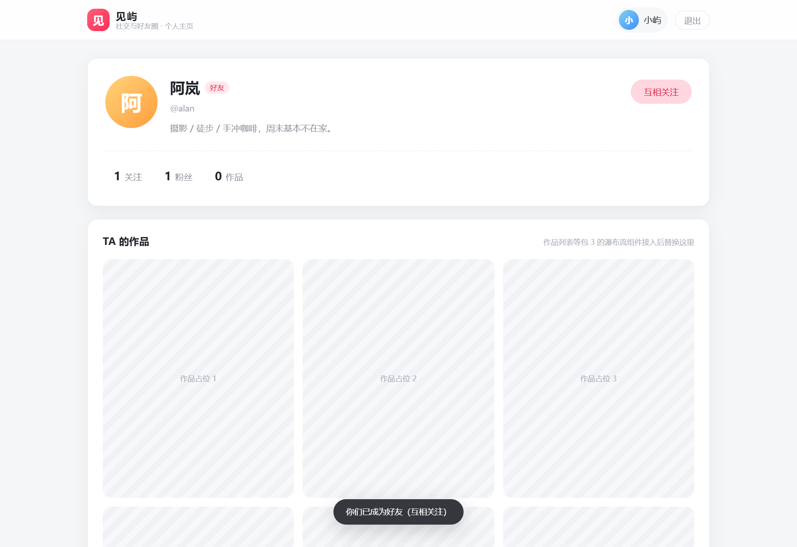
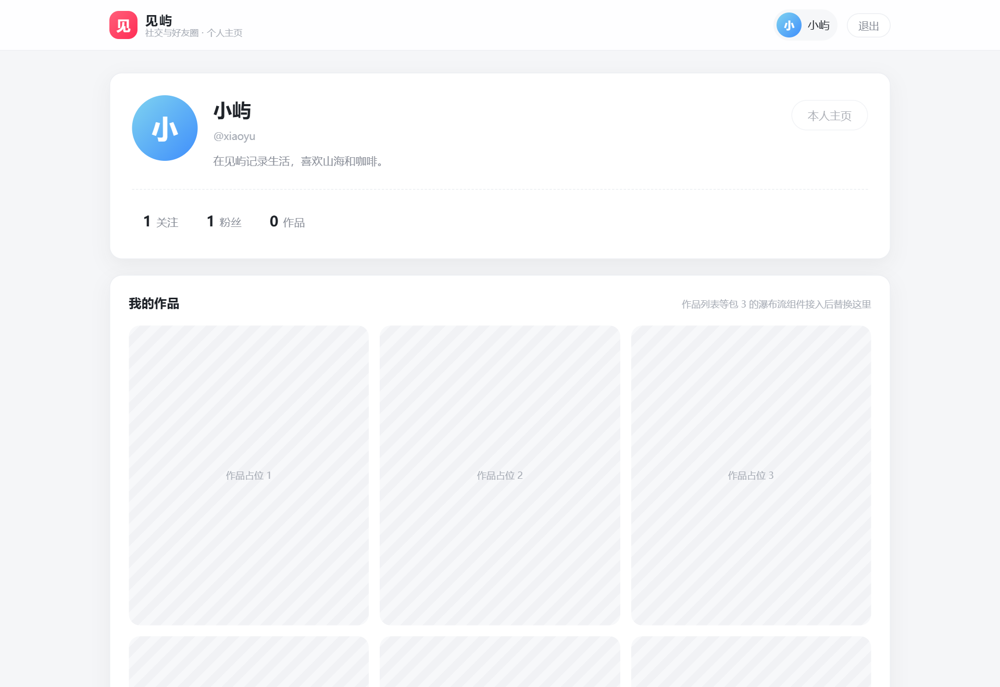
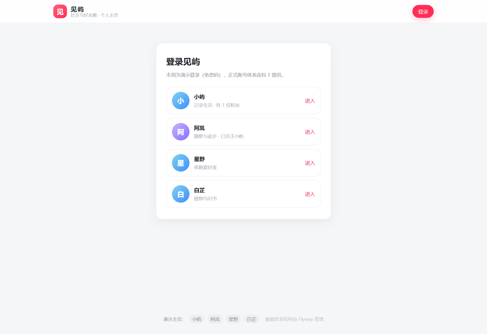
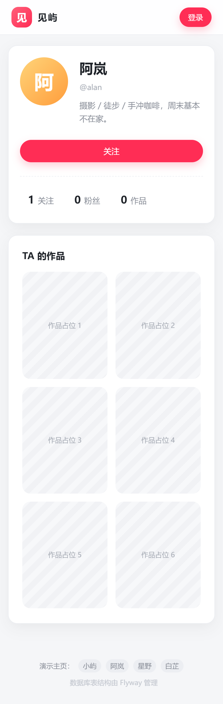

# 包 5 · 社交与好友圈 · 第 1 周交付说明

> 负责人：叶立铭（包 5）
> 本周范围：**关注 / 取关 + 个人主页**（基本功能版，扩展与美术后续再补）
> 分支：`feat/social-follow-profile`（基于 `dev`）
> 状态：后端接口 + 前端页面 + Flyway 脚本 + 10 个集成测试全部跑通，本机可独立演示

---

## 0. 本周交付了什么

| 交付物 | 位置 | 说明 |
| :--- | :--- | :--- |
| 关注关系表（Flyway） | `apps/backend/src/main/resources/db/migration/V20261125_01__init_user_follows.sql` | 正式脚本，PostgreSQL 可直跑 |
| 社交模块后端 | `apps/backend/src/main/java/com/community/module/social/` | Controller / Service / Repository / DTO / 用户信息端口 |
| 后端最小可运行骨架 | `apps/backend/`（`pom.xml`、`mvnw`、`application.yml`、`common/`） | 包 1 底座未落地前的临时脚手架，接口契约与设计文档一致 |
| 个人主页前端 | `apps/web-user/src/views/ProfileView.vue` | 资料区、关注/粉丝数、关注按钮、作品区占位 |
| 关注/粉丝列表前端 | `apps/web-user/src/views/FollowListView.vue` | 两个 tab、分页加载、行内关注按钮 |
| 演示登录页 | `apps/web-user/src/views/LoginView.vue` | 临时免密登录（正式版由包 1 替换） |
| 接口契约 | 本文档第 2 节 | 与设计文档第 5 节一致 |
| 集成测试 | `apps/backend/src/test/java/com/community/module/social/SocialApiIntegrationTest.java` | 10 个用例，覆盖主流程 + 异常分支 |

本周**没有**做（下周再排）：关注流、好友可见作品过滤、主页编辑资料、头像上传、拉黑、主页作品真实数据、Knife4j 注解。

---

## 1. 怎么跑起来（本机 5 分钟）

### 1.1 环境要求

- JDK 17 及以上（本机 JDK 25 已验证）
- Node.js 20.19+ / 22.12+（Vite 7 的要求）+ pnpm
- 本周演示**不需要** Docker / PostgreSQL / Redis：后端用 H2 内存库 + Flyway，启动即建表并灌演示数据

### 1.2 启动后端

```powershell
cd apps/backend
.\mvnw.cmd spring-boot:run      # Windows
# ./mvnw spring-boot:run        # macOS / Linux
```

- 首次运行 `mvnw` 会自动下载 Maven，无需本机安装
- 启动后接口地址：`http://localhost:8080/api/v1`
- H2 控制台：`http://localhost:8080/h2-console`（JDBC URL `jdbc:h2:mem:jianyu`，用户 `sa`，密码空）
- 跑测试：`.\mvnw.cmd test`

### 1.3 启动前端

```powershell
cd apps/web-user
pnpm install
pnpm dev
```

打开 `http://localhost:5173/u/1`。Vite 已配置 `/api` → `http://localhost:8080` 代理，无需处理跨域。

> `pnpm install` 若提示 `ERR_PNPM_IGNORED_BUILDS`（esbuild 安装脚本被拦截），不影响构建与运行，可执行 `pnpm approve-builds` 选择 esbuild 消除提示。

### 1.4 演示脚本（给组长看的 3 分钟）

1. 打开 `http://localhost:5173/u/2`：游客视角看阿岚主页，右侧按钮是「关注」
2. 点右上角「登录」→ 选「小屿」→ 自动回到小屿主页
3. 点页脚「阿岚」进入阿岚主页 → 点「关注」
   - 因为演示数据里阿岚本来就关注小屿，所以状态立刻变成 **「互相关注」**，昵称旁出现「好友」徽标
   - 粉丝数 0 → 1
4. 点粉丝数「1」进入粉丝列表：能看到小屿，行内按钮显示关注状态
5. 回到阿岚主页点「互相关注」→ 变回「关注」，互关标记解除（粉丝列表里阿岚仍关注小屿，但 `is_mutual` 已回退）

演示账号（`/login` 页点选即可，免密码）：小屿 `xiaoyu`(1)、阿岚 `alan`(2)、星野 `xingye`(3)、白芷 `baizhi`(4)。

---

## 2. 接口契约（本周已实现）

统一响应体、分页结构、错误码号段沿用设计文档第 5 节：

```json
{ "code": 0, "message": "ok", "data": {}, "traceId": "5b7ca549b0b2" }
```

| 方法 | 路径 | 鉴权 | 说明 |
| :--- | :--- | :--- | :--- |
| GET | `/api/v1/users/{userId}/profile` | 可选登录 | 个人主页聚合：资料 + 关注数/粉丝数 + 相对访问者的关注状态 |
| POST | `/api/v1/users/{userId}/follow` | 必须登录 | 关注（幂等，重复调用不新增记录） |
| DELETE | `/api/v1/users/{userId}/follow` | 必须登录 | 取关（幂等，并把反向关系的互关标记回退） |
| GET | `/api/v1/users/{userId}/followers` | 可选登录 | 粉丝列表，`page`/`pageSize`（默认 1/20，`pageSize` ≤ 50） |
| GET | `/api/v1/users/{userId}/following` | 可选登录 | 关注列表，同上 |
| POST | `/api/v1/auth/demo-login` | 公开 | **临时**演示登录：`{"username":"xiaoyu"}` → `{token, userId, ...}` |
| GET | `/api/v1/auth/me` | 必须登录 | **临时**取当前登录用户，供前端刷新会话 |

### 2.1 响应示例

个人主页（游客视角）：

```json
{
  "code": 0,
  "message": "ok",
  "data": {
    "userId": 2,
    "username": "alan",
    "nickname": "阿岚",
    "avatarUrl": null,
    "bio": "摄影 / 徒步 / 手冲咖啡，周末基本不在家。",
    "followerCount": 0,
    "followingCount": 1,
    "isSelf": false,
    "isFollowing": false,
    "isMutual": false
  },
  "traceId": "5b7ca549b0b2"
}
```

关注/取关返回最新状态，前端直接用它刷新按钮和粉丝数，不用再查一次主页：

```json
{ "code": 0, "message": "ok", "data": { "isFollowing": true, "isMutual": true, "followerCount": 1 }, "traceId": "990ff15e80fa" }
```

关注/粉丝列表（`PageResult`）：

```json
{
  "code": 0,
  "message": "ok",
  "data": {
    "items": [
      { "userId": 1, "username": "xiaoyu", "nickname": "小屿", "avatarUrl": null,
        "bio": "在见屿记录生活，喜欢山海和咖啡。", "isFollowing": false, "isMutual": false }
    ],
    "page": 1, "pageSize": 10, "total": 1, "hasMore": false
  },
  "traceId": "0b3b108c81ca"
}
```

### 2.2 错误码（本模块）

| HTTP | code | 场景 |
| :--- | :--- | :--- |
| 400 | 50001 | 不能关注自己 |
| 404 | 50002 | 目标用户不存在或已停用 |
| 401 | 20001 | 未登录 / Token 无效（关注、取关、`/auth/me` 需要登录） |
| 400 | 10001 | 分页参数非法（`page < 1`，或 `pageSize` 不在 1~50） |

---

## 3. 数据库

### 3.1 正式脚本

`apps/backend/src/main/resources/db/migration/V20261125_01__init_user_follows.sql`

```sql
CREATE TABLE IF NOT EXISTS user_follows (
    id          BIGINT GENERATED BY DEFAULT AS IDENTITY PRIMARY KEY,
    follower_id BIGINT                   NOT NULL,
    followee_id BIGINT                   NOT NULL,
    is_mutual   BOOLEAN                  NOT NULL DEFAULT FALSE,
    created_at  TIMESTAMP WITH TIME ZONE NOT NULL DEFAULT CURRENT_TIMESTAMP,
    CONSTRAINT uk_user_follows_pair UNIQUE (follower_id, followee_id),
    CONSTRAINT ck_user_follows_not_self CHECK (follower_id <> followee_id),
    CONSTRAINT fk_user_follows_follower FOREIGN KEY (follower_id) REFERENCES sys_user (id) ON DELETE CASCADE,
    CONSTRAINT fk_user_follows_followee FOREIGN KEY (followee_id) REFERENCES sys_user (id) ON DELETE CASCADE
);
CREATE INDEX IF NOT EXISTS idx_user_follows_followee_mutual ON user_follows (followee_id, is_mutual);
CREATE INDEX IF NOT EXISTS idx_user_follows_follower ON user_follows (follower_id);
```

设计要点：

- **单向一行**：`A → B` 与 `B → A` 同时存在即互关（好友），与设计文档 3.2 一致
- `is_mutual` 冗余标记在关注/取关时同步维护，之后「仅好友可见」作品查询不用做自连接
- 唯一约束兜底并发重复关注；自关注由 CHECK + 服务端双重拦截
- 时间统一 `TIMESTAMPTZ`，后端输出 ISO-8601

### 3.2 脚本执行顺序（重要）

`sys_user` 是包 1 的 V1 基线表，本模块不重复创建。本周为了脱离底座独立演示，额外加了两个**演示专用**脚本：

| 脚本 | 作用 | 包 1 落地后 |
| :--- | :--- | :--- |
| `db/demo/V20261125_00__demo_sys_user.sql` | 建最小 `sys_user`（仅演示用字段） | 删除整个 `db/demo` 目录 |
| `db/demo/V20261125_02__demo_seed_data.sql` | 4 个演示账号 + 1 条初始关注 | 同上 |

版本号必须 `00 < 01 < 02`，否则外键和种子数据会失败。正式环境只需要 `db/migration` 一个目录（`application.yml` 里去掉 `classpath:db/demo` 即可）。

---

## 4. 后端设计

```
module/social/
├── controller/SocialController.java    # 5 个接口，只做参数接收与响应包装
├── service/SocialService.java          # 业务规则：互关维护、幂等、分页校验
├── repository/
│   ├── UserFollowRepository.java       # 全部 SQL（PostgreSQL / H2 兼容）
│   └── FollowRow.java                  # 列表查询行（已按访问者算好关注状态）
├── dto/                                # UserProfileVO / UserBriefVO / FollowStateVO
└── spi/
    ├── SocialUser.java                 # 社交模块需要的用户只读视图
    └── SocialUserDirectory.java        # 查询用户信息的端口（接口）
```

几条关键设计说明（方便 review）：

1. **不直接依赖用户表**：社交模块通过 `SocialUserDirectory` 端口取用户信息，本周由 `com.community.system.SysUserDirectory` 适配，包 1 的 `SysUserService` 落地后换实现即可，`module/social` 零改动。
2. **关注幂等**：`insertIfAbsent` 捕获 `DuplicateKeyException`，重复关注不报错、不重复计数；唯一约束是并发兜底。
3. **互关维护**：关注时先插入我的关注行，再判断反向是否存在，存在则把**两条**记录的 `is_mutual` 都置为 true；取关时删除我的关注行，并把反向记录回退为 false（对方仍关注我，但不再是好友）。
4. **游客可读**：`/profile`、列表接口游客可访问，`isFollowing/isMutual` 相对访问者计算；游客的 `viewerId` 用 0 参与 LEFT JOIN，不会命中真实用户。
5. **统一异常**：业务代码只抛 `BusinessException`，由 `GlobalExceptionHandler` 转成 HTTP 状态 + `{code,message,traceId}`；traceId 由 `TraceIdFilter` 生成并回写响应头 `X-Trace-Id`。
6. **SQL 可移植**：没有用 `ON CONFLICT`、`jsonb` 等 PG 专属写法，H2（PostgreSQL 兼容模式）与 PostgreSQL 16 都能跑，方便本周演示、之后切库不改代码。

### 4.1 临时脚手架清单（包 1 合入后要替换/删除）

| 位置 | 内容 | 替换方式 |
| :--- | :--- | :--- |
| `com.community.demo.*` | 演示登录、`Bearer demo-<id>` 令牌、认证拦截器 | 换成包 1 的 Spring Security + JWT，删除整个 `demo` 包 |
| `com.community.system.*` | 最小 `sys_user` 查询 | 换成调用包 1 的 `SysUserService`，或保留 `SysUserDirectory` 适配 |
| `common/web/WebMvcConfig.java` | 注册 demo 拦截器 | 删除拦截器注册，保留 `CurrentUserArgumentResolver`（改为从 SecurityContext 取） |
| `application.yml` 数据源段 | H2 内存库 + `db/demo` location | 换成 `application-dev-local.yml`（PostgreSQL + Redis） |
| `db/demo/**` | 演示账号与种子关注 | 删除，种子数据统一由包 8 维护 |
| `common/**`（响应、异常、traceId、分页） | 与设计文档契约一致 | 合入包 1 的 `common`，保留即可 |

---

## 5. 前端设计

| 路由 | 页面 | 说明 |
| :--- | :--- | :--- |
| `/u/:userId` | `ProfileView.vue` | 个人主页（他人 / 本人同一套页面，按 `isSelf` 切按钮） |
| `/u/:userId/followers` | `FollowListView.vue` | 粉丝列表 |
| `/u/:userId/following` | `FollowListView.vue` | 关注列表 |
| `/login` | `LoginView.vue` | 演示登录（正式版由包 1 的登录弹窗替换） |

- `components/FollowButton.vue`：三态按钮（关注 / 已关注 / 互相关注），未登录点击自动跳登录并带 `redirect`，关注成功后用接口返回的状态就地刷新，不整页重载
- `components/AvatarBadge.vue`：有 `avatarUrl` 用图片，否则用昵称首字 + 渐变色兜底（演示数据没有头像，避免了外链图片断网打不开）
- `api/http.js`：统一处理「响应体 code + 业务错误码 + 401」，换成 `packages/shared` 的 Axios 封装时只改这一个文件
- 样式：`styles/main.css`，小红书风格浅色卡片 + 品牌红 `#ff2d55`，已做 720px 以下的移动端适配。美术精修和 Tailwind 迁移放到后续阶段

---

## 6. 测试

```powershell
cd apps/backend
.\mvnw.cmd test
```

本机结果：`Tests run: 10, Failures: 0, Errors: 0`。

| # | 用例 | 覆盖点 |
| :--- | :--- | :--- |
| 1 | 游客查看他人主页 | 资料、粉丝数/关注数、三个状态位均为 false |
| 2 | 关注后成为互关 | 状态回写、双方视角的 `isMutual`、粉丝数 |
| 3 | 重复关注幂等 | 不新增记录、计数不变 |
| 4 | 取关后互关回退 | 双向 `is_mutual` 归 false，对方仍关注我 |
| 5 | 不能关注自己 | 400 / 50001 |
| 6 | 关注不存在的用户 | 404 / 50002 |
| 7 | 游客不能关注 | 401 / 20001 |
| 8 | 粉丝列表 | 分页结构、访问者状态、`total` / `hasMore` |
| 9 | 关注列表 | 倒序、分页、行内关注状态 |
| 10 | 分页参数非法 | 400 / 10001 |

用例之间用 `@BeforeEach` 重置关注表，保证互不污染。

---

## 7. 与其它包的对接点

| 对接方 | 事项 | 本周状态 |
| :--- | :--- | :--- |
| 包 1（曾子煜） | `sys_user` 表字段、`/auth/login` 与 `/auth/me` 契约、401 处理、`common` 合并、Knife4j 注解 | 已按设计文档契约实现临时版，接口路径与字段可直接替换 |
| 包 3（韩瑞凯） | 主页「作品」区替换成瀑布流组件，作品数改为真实统计 | 目前是 6 个占位卡片，组件接入后替换 `ProfileView.vue` 里 `.post-grid` 一段即可 |
| 包 6（周家琦） | 后台用户管理删除用户后，`user_follows` 由 ON DELETE CASCADE 自动清理 | 表已建好级联，无需额外处理 |
| 包 7（李希宇） | 主页「好友」标识可用于好友作品推荐 | `is_mutual` 字段已冗余，可直接查询 |
| 包 8（陈建辉） | 种子数据、部署 | 演示数据暂放 `db/demo`，正式种子数据由包 8 统一维护 |

---

## 8. 下周计划（阶段 2）

1. 关注流（关注的人的动态列表，按时间倒序 + 分页）
2. 「仅好友可见」作品列表过滤：`visibility = FRIENDS` 时用 `is_mutual` 判定
3. 个人主页补齐：作品列表真实数据（接包 2/3）、关注/粉丝数缓存与一致性
4. 关注按钮防连点、失败重试、空态/错误态补充
5. 与包 1 底座合并，补 Knife4j 注解与接口文档
6. 测试补充：并发重复关注、分页边界、封禁用户

---

## 9. 提交信息

- 分支：`feat/social-follow-profile`，基于 `dev`，未直接改动 `main`
- 数据库变更只走 Flyway（`V20261125_01`），没有手工建表
- 未提交 `node_modules`、`target`、`dist` 等构建产物（`.gitignore` 已覆盖）

---

## 10. 界面截图（本机 Chrome 实测）

桌面端：小屿关注阿岚后成为「互相关注」，昵称旁出现「好友」徽标，粉丝数 0 → 1。



本人视角：作品区标题为「我的作品」（他人主页显示「TA 的作品」）。



登录页（演示免密登录，正式版由包 1 替换）：



移动端 390px 宽自适应：



